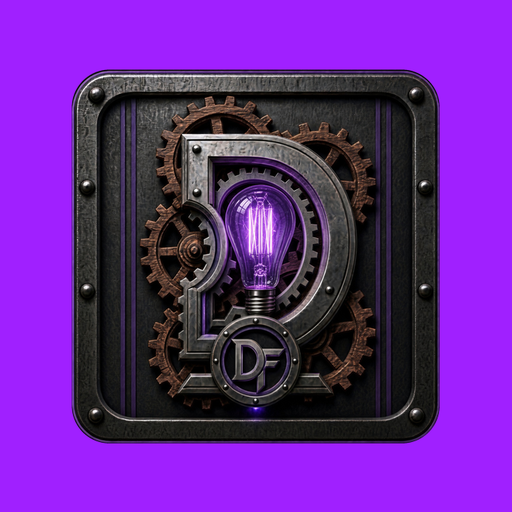

<p align="center">
  
</p>

# DreamForge

**Your words are your prompts.**

DreamForge is an AI app studio. You describe what you want in plain words, and the workshop walks you through building it — a song outline, a picture brief, a storyboard, a campaign plan, and more.

This repository is the **Founders Edition** beta: an unrestricted developer sandbox with no consumer gates, paywalls, or daily limits.

## What's in this build

The website is a local workshop with seven core modes, plus a Kids Factory teaser reserved for a later, separate build:

| Mode | What works today |
| --- | --- |
| **Music** | Song notebook and outline. Audio generation, voice matching, auto-tune, and the built-in beat engine are not connected. |
| **Picture** | Text picture brief. Image generation and photo editing are not connected. Reference files stay on your device. |
| **Video** | Storyboard planner. Video rendering is not connected. Platform ad rules are not checked automatically. |
| **Brainstormer** | Project notebook. **Talk it through** can send your notes to DeepSeek (the crew council) when a key is configured. Real Talk stays separate from project drafts. |
| **Marketing** | Campaign plan and checklist. Nothing is posted or connected to a social account. |
| **Teacher** | Research journal you fill in yourself. No background researcher is running. |
| **Money** | Price calculator from the numbers you enter. These are estimates, not financial advice. Bank sync, live competitor research, and grant discovery are not connected. |

Drafts live in session state only. You can download and restore them as JSON. There is no automatic cloud or browser-storage persistence.

A media pipeline is sketched in for later image/video work: on a PC, saves can use the File System Access API or a download; on a phone, saves can land in an IndexedDB bucket. The optional `bridge.py` server can receive files from a phone onto the PC. Image and video **generation** itself is not wired yet — the bridge's `/generate/*` endpoints return 501 until you point `GENERATOR_URL` at a real generator.

The in-app crew (DREAM, Nyna, Big Unk, Go Getta, Get'er Done, and Jack) appears in the workshop UI.

## Requirements

- [Bun](https://bun.sh) (this is a Bun project; `npm install` fails here)
- Node.js is used at runtime by `bun run start` (`node .output/server/index.mjs`)
- Python 3, only if you want to run `bridge.py` (standard library only, no extra packages)
- A DeepSeek API key (or Lovable + DeepSeek connector keys) only if you want Brainstormer "Talk it through" to call the council

## Quick start

```bash
git clone https://github.com/<your-account>/dreamforge.git
cd dreamforge
bun install
cp .env.example .env
# Edit .env and fill in any keys you have.
bun run dev
```

Then open http://localhost:3000/

For a production-style local run:

```bash
bun run build
bun run start
```

### Windows one-click option

1. Clone or extract the project so you can see `package.json` in the folder (do not run the script from inside a zip).
2. Double-click `RUN-FOUNDER-EDITION.bat`.
3. If Bun is missing, the script installs it and asks you to run the file again.
4. It runs `bun install`, `bun run build`, and `bun run start`. Keep the window open while you use the app.

See `START-HERE.txt` and `FOUNDER-EDITION.md` for the same steps in more detail.

### Phone-to-PC saves

In a separate terminal on the PC:

```bash
python bridge.py
```

The script prints your LAN IP. Put that IP into `VITE_GENERATOR_LAN_URL` in `.env`, then restart or rebuild the app so the value is picked up.

## Configuration

Copy `.env.example` to `.env`. You can also use Vite's `.env.development` and `.env.production` files. Real env files are gitignored; only `.env.example` is committed.

| Variable | Where it is used | What to put |
| --- | --- | --- |
| `VITE_DEFAULT_IS_PC` | Build-time fallback in `src/config/environment.ts` | `true` for local PC dev. Leave empty in production; a desktop User-Agent still counts as a PC. Runtime detection (URL `?pc=1`, `localStorage force-pc`, then User-Agent) wins over this value. |
| `VITE_GENERATOR_API_URL` | Client, inlined at build time | Default `http://127.0.0.1:8898` — the local bridge. |
| `VITE_GENERATOR_LAN_URL` | Client, inlined at build time | Your PC's LAN or VPN IP, for example `http://192.168.1.10:8898`. Required for a phone; `127.0.0.1` on a phone means the phone itself. `bridge.py` prints the LAN IP on startup. |
| `DEEPSEEK_API_KEY` | Server only | Your DeepSeek key for Brainstormer "Talk it through". Leave blank to disable that path. |
| `LOVABLE_API_KEY` and `UDC_DEEPSEEK_API_KEY` | Server only | Alternative to `DEEPSEEK_API_KEY`: both are required together to use Lovable's DeepSeek connector gateway. |
| `GENERATOR_URL` | `bridge.py` (process environment) | Optional URL of a real image/video generator. Until this is set (or the handlers are replaced), `/generate/image` and `/generate/video` return 501. |

`VITE_*` values are inlined at **build** time. After changing them, restart `bun run dev` or run `bun run build` again.

Do not put API keys in client code. The DeepSeek / Lovable keys are read only on the server in `src/lib/deepseek.server.ts`.

## Project structure

```
.
├── .env.example              # Variable names and placeholders
├── RUN-FOUNDER-EDITION.bat   # Windows install / build / start
├── START-HERE.txt            # Short Windows zip-and-run notes
├── FOUNDER-EDITION.md        # What this edition includes
├── PIPELINE.md               # Media pipeline status and bridge setup
├── AGENTS.md                 # Contributor notes (includes Lovable rules)
├── bridge.py                 # Optional PC server on port 8898
├── docs/icon.png             # App icon
├── public/                   # Favicon, web manifest, robots.txt
└── src/
    ├── assets/               # Mode art, logo, crew portraits
    ├── components/           # Workshop UI and shadcn-style primitives
    ├── config/environment.ts # PC vs phone detection, generator URLs
    ├── lib/
    │   ├── dreamforge.ts     # Modes, crew, and skit data
    │   ├── workflows.ts      # Mode forms, validation, draft text
    │   ├── pipeline.ts       # Local save helpers
    │   ├── engine-modes.ts   # Founders Edition deployment mode
    │   ├── deepseek.server.ts
    │   └── council.functions.ts
    ├── routes/               # TanStack Router pages and /api/council
    ├── server.ts             # Local Node server entry
    └── start.ts
```

Useful scripts from `package.json`:

- `bun run dev` — Vite dev server
- `bun run build` — production build to `.output/`
- `bun run start` — run the built Node server
- `bun run test` — Vitest
- `bun run lint` / `bun run format`

Stack: Bun, Vite, TanStack Start, React 19, TypeScript, Tailwind CSS.

## License

No license file is included yet, so the default copyright rules apply. A license still needs to be chosen before this is treated as open source. Add a `LICENSE` file when you are ready; this repository does not pick one for you.
